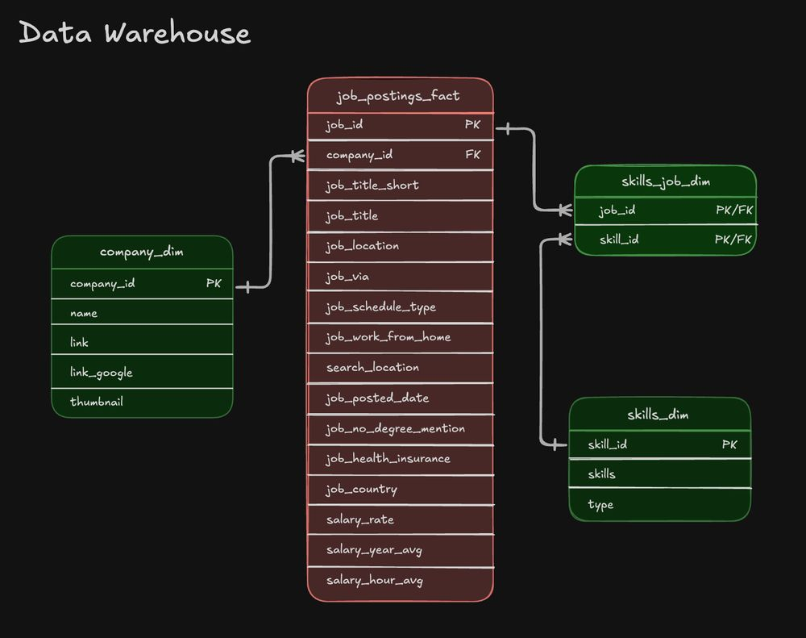
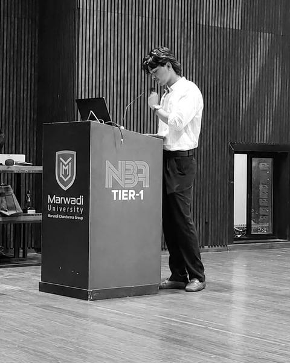
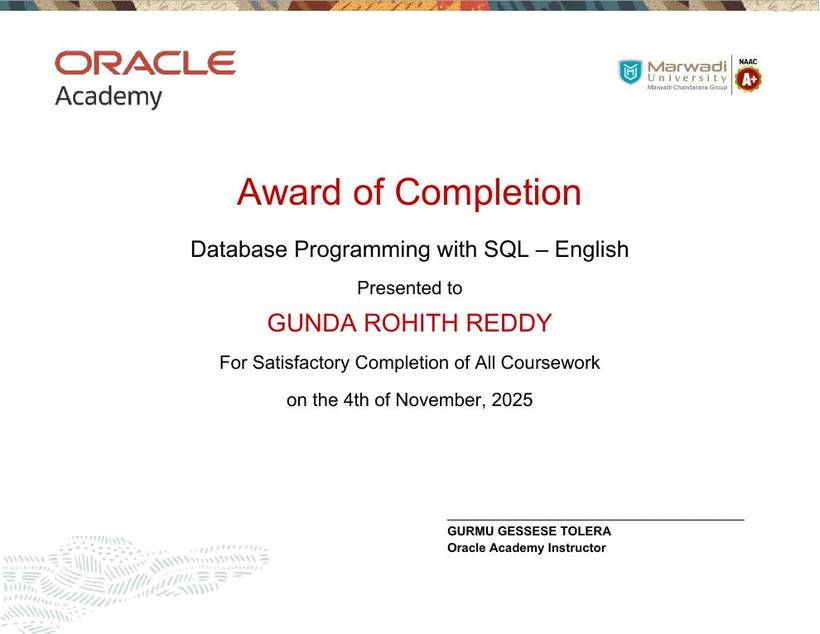
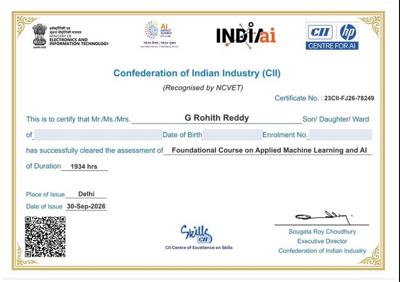
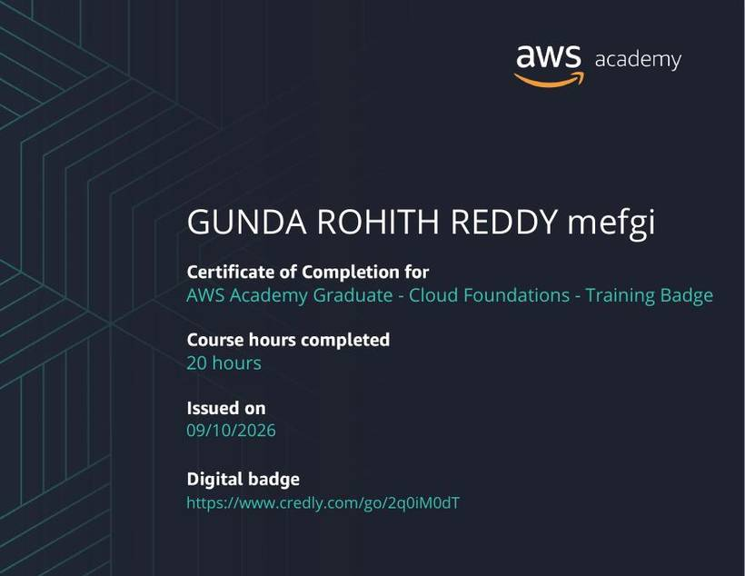
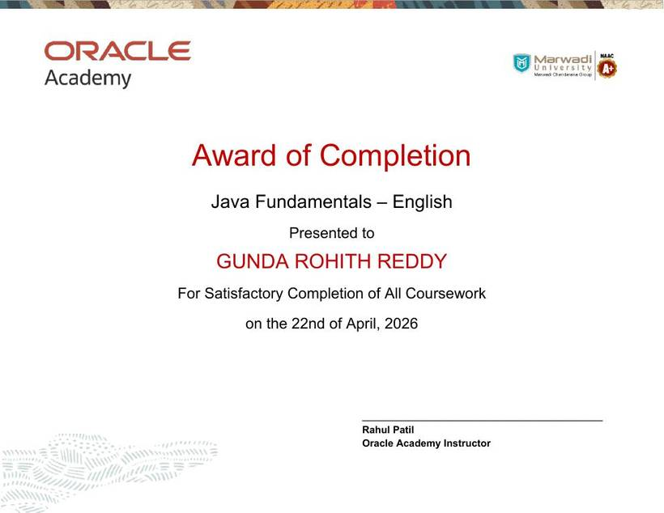
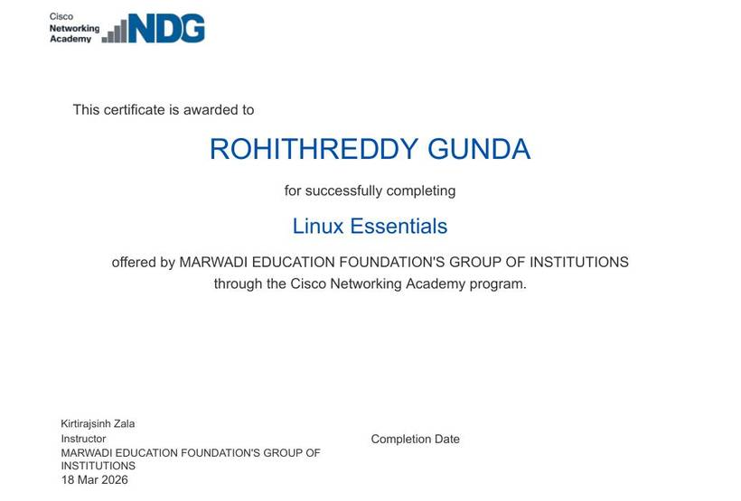
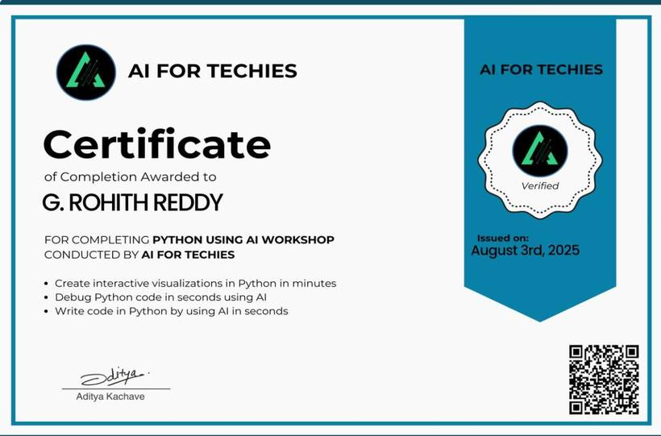

<div align="center">
  

  # G. Rohith Reddy

  ### Aspiring Data Engineer · CSE–AI Student

  **Turning raw data into useful answers.**

  [](https://github.com/RohithReddy17G)
  [](https://www.linkedin.com/in/gunda-rohith-reddy-234a17359/)
  [](mailto:gundarohithreddy@gmail.com)
</div>

---

## About me

I’m **G. Rohith Reddy**, a B.Tech student in **Computer Science and Engineering (Artificial Intelligence)** at **Marwadi University**. I’m building toward data engineering through SQL analysis, DuckDB projects, ETL work, practical certifications, and consistent documentation on GitHub.

I enjoy the practical middle layer between raw information and useful decisions: understanding a question, cleaning and transforming data, writing readable SQL, and presenting an analytical result that another person can follow.

- **Current direction:** Data engineering and analytics
- **Education:** B.Tech, CSE–AI · Marwadi University
- **Academic record:** 7.25 CGPA after four semesters
- **Open to:** Data engineering internships and entry-level opportunities

## What I work on

| Focus | What it means in practice |
|---|---|
| **SQL analysis** | Turning broad questions about demand, compensation, volume, and spending into measurable queries. |
| **Data transformation** | Cleaning raw records and shaping them into structured analytical outputs. |
| **Warehouses and marts** | Learning how raw data moves through warehouse layers into focused reporting marts. |
| **Documentation** | Keeping project logic, queries, decisions, and results understandable to another person. |

---

## Featured projects

### 1. Data Warehouse & Mart Build — Production ETL Pipeline

An end-to-end warehouse and marts build that documents the path from raw CSV data to analytical structures.

**Project evidence:**

- Raw CSVs → warehouse → marts pipeline structure
- Warehouse star-schema foundation
- Skills mart with additive measures by month
- Priority mart with incremental `MERGE` updates
- Master build script, update script, and documented repository structure

[Open the DW mart build](https://github.com/RohithReddy17G/sql_data_engineering_projects/tree/main/2_DW_MART_build)

<div align="center">
  
</div>

### 2. Data Jobs Analysis — SQL Data Engineering Projects

A documented SQL project exploring the data-engineering job market through three practical questions:

- Which skills are most in demand?
- Which roles offer the highest salaries?
- Which skills balance demand and compensation best?

**Tools:** SQL · DuckDB · Visual Studio Code · Git · GitHub

[Repository](https://github.com/RohithReddy17G/sql_data_engineering_projects) · [Top-demanded skills query](https://github.com/RohithReddy17G/sql_data_engineering_projects/blob/main/Lessons/1_EDA/01_top_demanded_skills.sql) · [Top-paying jobs query](https://github.com/RohithReddy17G/sql_data_engineering_projects/blob/main/Lessons/1_EDA/02_top_paying.sql) · [Most optimal skills query](https://github.com/RohithReddy17G/sql_data_engineering_projects/blob/main/Lessons/1_EDA/03_most_optimal.sql)

### 3. Automated Sales ETL Pipeline

A SQL-based ETL project working with raw, messy e-commerce order and delivery records and producing structured analytical summaries of customer spending and order volume.

**Flow:** raw records → SQL transformation logic → analytical summaries

[Open the ETL repository](https://github.com/RohithReddy17G/automated-sales-etl-pipeline)

---

## Technical toolkit

<div align="center">

| Area | Skills |
|---|---|
| **Databases and data** | SQL · DuckDB · data cleaning · fact and dimension tables |
| **Programming** | Python learning · Java · C · C++ |
| **Tools** | Git · GitHub · Visual Studio Code |
| **Foundations** | Linux · AWS cloud foundations · machine learning · AI fundamentals |

</div>

---

## Achievements and education

### Hosted an Expert Show

Hosted an Expert Show attended by **1,500 students**, strengthening communication, presentation, and audience-engagement skills alongside technical work.

### Education

**B.Tech — Computer Science and Engineering (Artificial Intelligence)**  
Marwadi University, Rajkot · 2024–2028 expected  
**7.25 CGPA after four semesters · currently in the fifth semester**

Additional academic record:

- Intermediate, Vamsi Junior College, Srikalahasti · 80.9%
- Secondary School, Bhashyam High School, Srikalahasti · 86.8%
- Relevant coursework: Database Management Systems, Data Structures, Python, Java, Machine Learning Essentials, Operating Systems and Virtualization, Probability and Statistics

<div align="center">
  
</div>

---

## Certifications and learning

<div align="center">
  
  
  
</div>

- **Database Programming with SQL** — Oracle Academy
- **Applied Machine Learning and AI** — Confederation of Indian Industry
- **AWS Academy Graduate: Cloud Foundations** — AWS Academy
- **Java Fundamentals** — Oracle Academy
- **Linux Essentials** — Cisco Networking Academy
- **Python using AI Workshop** — AI for Techies

<details>
<summary><strong>View more certificate evidence</strong></summary>

<div align="center">
  
  
  
</div>

</details>

---

## Portfolio website

The repository also contains the complete dependency-free static portfolio in [`index.html`](./index.html), extracted visual assets, and the downloadable resume.

To run it locally:

```bash
python3 -m http.server 3000
```

Then open [http://localhost:3000](http://localhost:3000) in Chrome.

[Download my resume](./assets/G_Rohith_Reddy_Resume.pdf)

---

## Let’s connect

I’m open to internship and entry-level data engineering opportunities where I can contribute with SQL, learn from experienced engineers, and keep turning messy data into clear outputs.

- **Email:** [gundarohithreddy@gmail.com](mailto:gundarohithreddy@gmail.com)
- **LinkedIn:** [linkedin.com/in/gunda-rohith-reddy-234a17359](https://www.linkedin.com/in/gunda-rohith-reddy-234a17359/)
- **GitHub:** [github.com/RohithReddy17G](https://github.com/RohithReddy17G)

<div align="center">
  <sub>Built with curiosity, SQL, and a steady commitment to learning.</sub>
</div>
